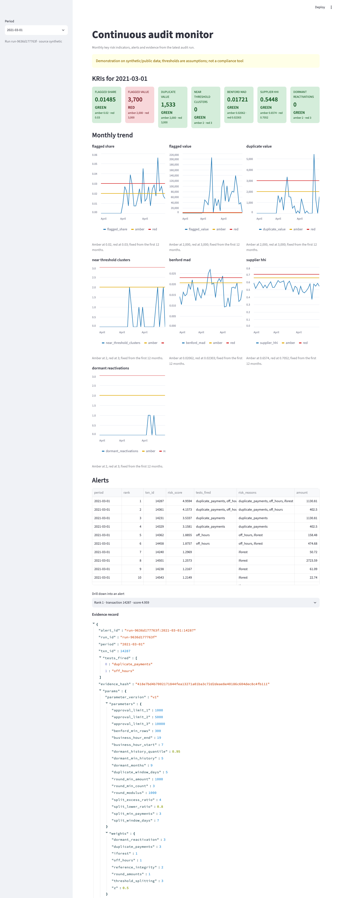
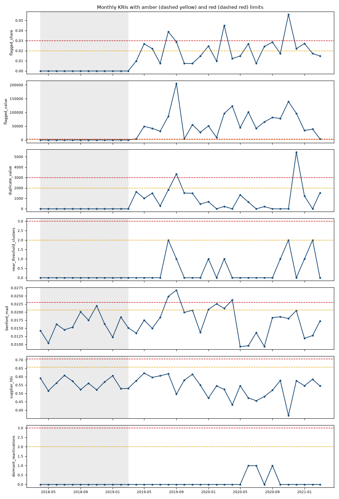
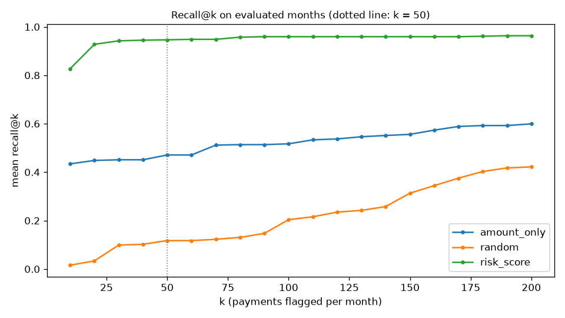
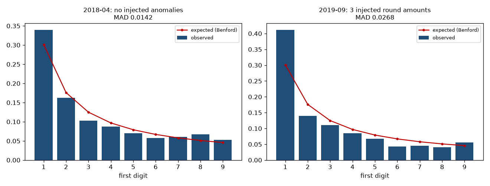
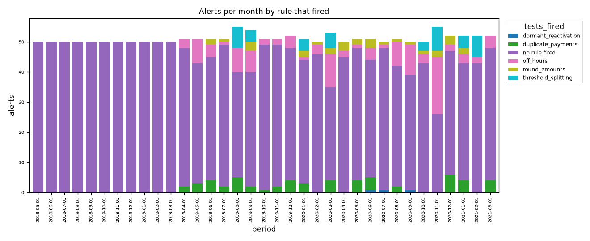

<div align="center">

# continuous-audit-lab

**Test every payment, rank the riskiest, and keep the evidence to re-perform each alert.**

A small, reproducible continuous-auditing analytics system built on DuckDB, scikit-learn and Streamlit, run on public council payments and a labelled synthetic ledger.




</div>

> **Scope:** a demonstration of audit-analytics techniques on public and synthetic data. It is not a compliance, AML or regulatory tool.

## Contents

[Why](#why) · [What it does](#what-it-does) · [Architecture](#architecture) · [Quick start](#quick-start) · [Results](#results) · [Real data](#real-public-data) · [Audit tests](#the-eight-audit-tests) · [Design choices](#design-choices) · [Limitations](#limitations) · [Docs](#documentation) · [Attribution](#data-attribution)

## Why

Sampling checks a few payments and misses the rest. An auditor with limited review time wants **every** payment tested, the riskiest exceptions ranked within reviewer capacity, and a trail showing why each one was raised.

## What it does

| Capability | How |
|---|---|
| Full-population tests | 8 readable `.sql` files run in DuckDB over every transaction |
| Ranking | Robust z-score (median/MAD), supplier deviation, isolation forest, combined into a transparent weighted risk score |
| Reviewer capacity | Top-*k* alerts per month (default 50) |
| No look-ahead | Each month is processed in order; tests, baselines and thresholds see only earlier data |
| Monitoring | 7 KRIs with red/amber/green status from a 12-month baseline |
| Evidence | Every alert stored with parameters, involved transactions and a sha256 hash; `reperform()` recomputes it |
| Honest evaluation | precision@k / recall@k against a random ranker and an amount-only ranker, on labelled synthetic data only |
| Data quality | Loader reports unmapped files, dropped rows and parse failures instead of hiding them |

## Architecture

```
public CSVs / synthetic generator
   -> canonical loader + data-quality report
   -> SQL audit tests (DuckDB, one .sql file per test)
   -> scoring: robust z-score, supplier deviation, isolation forest
   -> weighted risk score -> top-k alerts
   -> monthly runner -> run log, evidence store, KRIs + RAG   (runs/audit.duckdb)
   -> Streamlit dashboard
```

```
continuous_audit_lab/
  data/        download, canonical loader, synthetic generator
  tests_sql/   audit tests as .sql files, params.py, runner.py
  scoring/     stats, rule flags, risk score, evaluation
  monitor/     monthly runner, KRIs, evidence store
  dashboard/   Streamlit app
  cli.py       download, prepare, synth, run, report
tests/         pytest, deterministic seeds
docs/          METHODS, LIMITATIONS, INTERVIEW_NOTES, SPOTCHECK, figures
notebooks/     figures.ipynb regenerates every figure
```

## Quick start

Requires Python 3.11+. Offline, on synthetic data:

```bash
make install
make test
make synth
make run
.venv/bin/python -m continuous_audit_lab.cli report
make dashboard
```

`make figures` re-executes the notebook and regenerates everything in `docs/figures/`.

## Results

### Synthetic data (labelled)

Seed 42, 36 months, 400 payments a month. The first 12 months are a clean baseline; 24 months are evaluated at k = 50.

| ranker | mean precision@50 | mean recall@50 |
|---|---|---|
| **risk_score** | 0.153 | **0.946** |
| amount_only | 0.077 | 0.471 |
| random | 0.021 | 0.117 |

- Precision@50 is capped near 0.17 by design: about 8 anomalies are injected a month, so no ranking can fill 50 slots with true positives. Recall is the meaningful number.
- The run produced 1,750 alerts and 4,376,252.43 total value flagged.
- **These figures are optimistic.** The anomalies are injected by rules the tests were built to detect. They show the pipeline works, not accuracy on real fraud.

| | |
|---|---|
|  |  |
|  |  |

### Real public data (unlabelled)

70 monthly files, April 2014 to March 2020. 41,457 rows read, 41,435 kept (22 empty rows dropped), 0 date failures, 1 amount failure. The monitor ran over 72 months and raised 3,600 alerts (the 50-a-month cap), with 23,514,413.58 of payment value on alerted transactions.

**No accuracy is claimed here: there are no fraud labels.** Most alerts come from the duplicate-payment test, which on council data mostly catches recurring legitimate payments. That is a false-positive finding about the test, not evidence of misconduct. A manual spot-check template is in [docs/SPOTCHECK.md](docs/SPOTCHECK.md) and is intentionally blank until someone fills it in.

## Real public data

```bash
.venv/bin/python -m continuous_audit_lab.cli download --dry-run
make data
.venv/bin/python -m continuous_audit_lab.cli run --source real
.venv/bin/python -m continuous_audit_lab.cli report
```

`download --dry-run` reports total size first (70 CSVs, 13.7 MB when checked). Downloads are idempotent with recorded checksums. Raw and processed data are git-ignored. The loader maps varying headers, handles several date layouts including Excel serial numbers, and reports every row it cannot parse.

## The eight audit tests

Duplicate payments · threshold splitting · Benford first digits (MAD) · round and repeated amounts · off-hours postings · dormant-supplier reactivation · supplier concentration (HHI) · reference reuse and sequence gaps.

Each is a file in `continuous_audit_lab/tests_sql/` with a header giving purpose, red flag, parameters and known false positives. Approval limits (1,000 / 5,000 / 10,000) are assumptions, not any council's real limits. See [docs/METHODS.md](docs/METHODS.md).

## Design choices

- **SQL for tests, Python for scoring:** the tests are readable by an auditor; the statistics live where the libraries are.
- **Robust statistics:** median/MAD instead of mean/standard deviation, so outliers do not hide themselves.
- **Transparent score:** a weighted sum of named signals, not a black box, so every rank can be explained.
- **No leakage:** rolling windows use only data before the month being tested.
- **Reproducible evidence:** hashed alerts that can be re-performed from stored parameters.

## Limitations

- Real data has no labels, so no accuracy is claimed on it.
- Synthetic anomalies are rule-like, so recall is optimistic.
- Thresholds, weights and approval limits are assumptions.
- Benford's law does not fit every field, for example bounded or assigned amounts.
- On clean synthetic data the threshold-splitting test still raised 4 findings, and the `flagged_value` KRI is red in every evaluated synthetic month because the clean baseline is zero. That is a calibration artefact, not a finding.

Full list: [docs/LIMITATIONS.md](docs/LIMITATIONS.md).

## Documentation

| Doc | Contents |
|---|---|
| [METHODS.md](docs/METHODS.md) | Every test, score and KRI, with parameters |
| [LIMITATIONS.md](docs/LIMITATIONS.md) | 21 known limits and false-positive sources |
| [INTERVIEW_NOTES.md](docs/INTERVIEW_NOTES.md) | Design questions and answers |
| [SPOTCHECK.md](docs/SPOTCHECK.md) | Manual review template for real-data alerts |

## Data attribution

Real data: "Payments to suppliers over £250", South Lakeland District Council, published under the [Open Government Licence](https://www.nationalarchives.gov.uk/doc/open-government-licence/) via [data.gov.uk](https://ckan.publishing.service.gov.uk/dataset/payments-to-suppliers-over-250). Contains public sector information licensed under the Open Government Licence.
